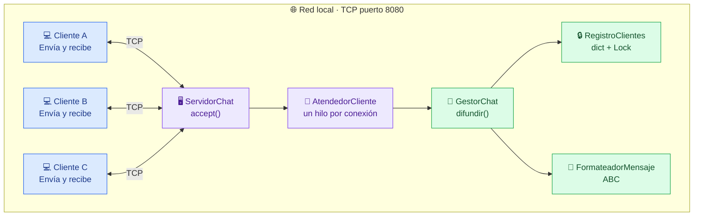
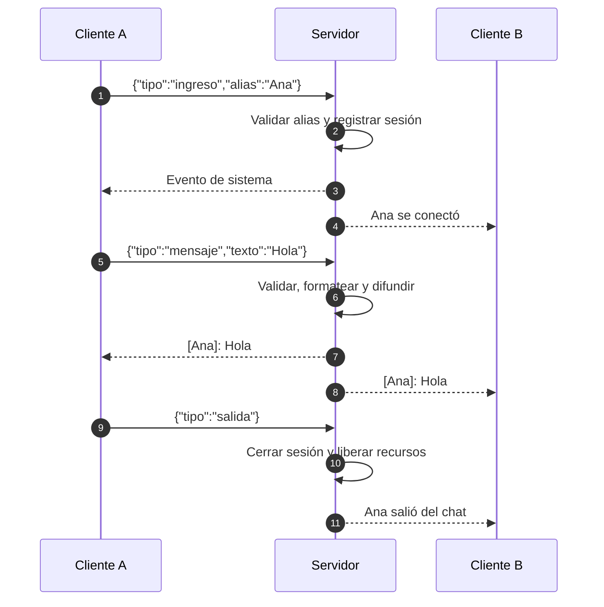
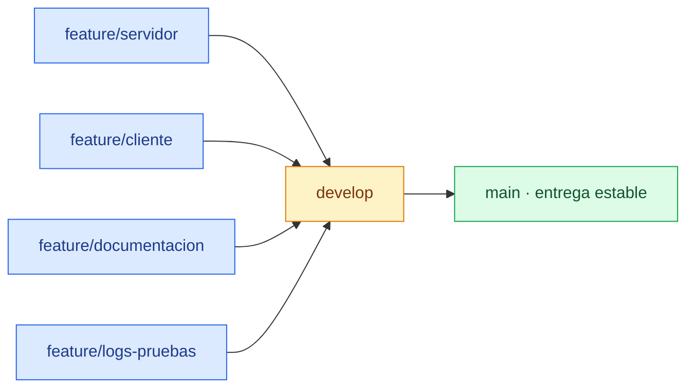

<a id="top"></a>
<div align="center">

<h1>💬 LAN CHAT</h1>
<h3>Chat multiusuario en tiempo real con Python y sockets TCP</h3>
<p><strong>Un servidor. Varios computadores. Una sola conversación.</strong></p>

<p>
  
  
  
</p>
<p>
  
  
  
  
</p>

<p><strong>Universidad Politécnica Salesiana · Sede Sur, Quito</strong><br/>
Carrera de Computación · <strong>Sistemas Distribuidos</strong><br/>
Docente: <strong>Ing. Ricardo Proaño</strong> · 16 de octubre de 2026</p>
<p>
<a href="#inicio-rapido">🚀 Inicio rápido</a> &nbsp;·&nbsp;
<a href="#arquitectura">🏗️ Arquitectura</a> &nbsp;·&nbsp;
<a href="#prueba-lan">🌐 Prueba LAN</a> &nbsp;·&nbsp;
<a href="#pruebas">🧪 Pruebas</a> &nbsp;·&nbsp;
<a href="#evidencias">📸 Evidencias</a>
</p>

</div>

---

> [!NOTE]
> **Taller grupal — Sockets multihilo.** Este proyecto transforma un servidor de eco básico en una aplicación de chat por consola que admite múltiples conexiones simultáneas dentro de una red local.

<table>
  <tr>
    <td align="center"><strong>🧵 Multihilo</strong><br />Un hilo de atención por cliente</td>
    <td align="center"><strong>📣 Broadcast</strong><br />Mensajes para todos los conectados</td>
    <td align="center"><strong>🛡️ Tolerante a desconexiones</strong><br />Una salida no detiene el servidor</td>
  </tr>
</table>

<a id="contenido"></a>
## 🧭 Contenido

| Explorar el proyecto | Ponerlo en marcha |
|---|---|
| [01 · Descripción](#descripcion) | [05 · Requisitos e instalación](#instalacion) |
| [02 · Funcionalidades](#funcionalidades) | [06 · Inicio rápido](#inicio-rapido) |
| [03 · Arquitectura y flujo](#arquitectura) | [07 · Conexión entre computadores](#prueba-lan) |
| [04 · Estructura del proyecto](#estructura) | [08 · Protocolo TCP + JSON](#protocolo) |
| [09 · Diseño SOLID](#solid) | [12 · Evidencias](#evidencias) |
| [10 · Registro de eventos](#logs) | [13 · Solución de problemas](#solucion-problemas) |
| [11 · Pruebas automatizadas](#pruebas) | [14 · Git y equipo](#git-equipo) |
| [15 · Próximas mejoras](#mejoras) | |

---

<a id="descripcion"></a>
## 01 · 🎯 ¿De qué trata el proyecto?

El sistema evoluciona de un **servidor de eco**, que atendía a un cliente a la vez y respondía únicamente a quien enviaba el mensaje, a un **chat multiusuario en consola** que permite comunicarse en tiempo real entre diferentes equipos de una misma red LAN.

El servidor centraliza las conexiones; cada cliente puede **escribir y recibir mensajes simultáneamente**. Los usuarios se identifican mediante un alias único y reciben notificaciones cuando alguien entra o sale.

**Así se ve una conversación:**

```text
╭────────────────────── CHAT LAN ──────────────────────╮
│                                                     │
│  [Sistema]: Juan Figueroa se conectó al chat        │
│  [Juan Figueroa]: Hola a todos                      │
│  [Alejandro]: ¡Hola, Juan!                          │
│  [Josué]: Ya estamos conectados 👋                   │
│                                                     │
│  Mensaje: _                                         │
╰─────────────────────────────────────────────────────╯
```

<sub>Representación ilustrativa de la conversación; no es una captura de la interfaz real.</sub>

<a id="funcionalidades"></a>
## 02 · ✨ Funcionalidades principales

| Funcionalidad | Implementación / comportamiento |
|:---|:---|
| 🧵 **Concurrencia** | El servidor utiliza `threading.Thread` para atender a cada cliente. |
| 📢 **Broadcast** | Los mensajes de un usuario se difunden a los clientes conectados. |
| ⌨️ **Envío y recepción simultáneos** | El cliente escribe desde el hilo principal y recibe en un hilo de escucha. |
| 🏷️ **Identificación** | Alias únicos de 1 a 20 caracteres, sin diferenciar mayúsculas y minúsculas. |
| 🔔 **Eventos del sistema** | Se informa cuando un usuario entra o abandona el chat. |
| 🔌 **Desconexiones controladas** | `/salir` permite finalizar una sesión de forma ordenada. |
| 🛡️ **Manejo de errores** | El servidor continúa operando si un cliente se desconecta inesperadamente. |
| 📦 **Mensajería estructurada** | Eventos JSON codificados en UTF-8 y separados por saltos de línea. |
| 🧾 **Auditoría** | Registros en consola y archivos con rotación. |
| 🧪 **Verificación** | Se documentan 3 pruebas unitarias y 3 de integración. |
| 🧱 **Diseño modular** | Clases con responsabilidades separadas y un formateador abstracto. |

---

<a id="arquitectura"></a>
## 03 · 🏗️ Arquitectura del sistema

Se utiliza un modelo **cliente–servidor sobre TCP/IP**. El servidor escucha conexiones entrantes, crea un hilo de atención por cliente, gestiona los usuarios activos y distribuye los mensajes.



### 🔁 ¿Qué sucede cuando se envía un mensaje?



**Responsabilidades clave:** `ServidorChat` acepta conexiones, `AtendedorCliente` gestiona una sesión, `GestorChat` coordina la difusión, `RegistroClientes` protege el acceso concurrente al conjunto de usuarios y `FormateadorMensaje` define la interfaz para construir el texto mostrado.

<a id="estructura"></a>
## 04 · 📂 Estructura del proyecto

```text
Taller-Grupal-Sockets-Multihilo/
│
├── app_servidor.py           # Inicia el servidor y lee sus argumentos
├── app_cliente.py            # Inicia el cliente y solicita el alias
├── requirements.txt          # Dependencia prompt_toolkit para el cliente
│
├── chat/                     # Lógica principal
│   ├── __init__.py
│   ├── protocolo.py           # Eventos JSON y validaciones
│   ├── formato.py             # FormateadorMensaje / FormateadorConsola
│   ├── registros.py           # Configuración de logging y rotación
│   ├── servidor.py            # Sesiones, registro, gestor y servidor
│   └── cliente.py             # ClienteChat y recepción concurrente
│
├── pruebas/
│   ├── __init__.py
│   └── test_chat.py           # Pruebas unitarias y de integración
│
├── logs/                     # Se genera durante la ejecución
│   ├── servidor.log
│   └── cliente.log
│
├── docs/
│   └── capturas/             # Evidencias de ejecución en LAN
│
└── README.md                 # Esta documentación
```

---

<a id="instalacion"></a>
## 05 · ⚙️ Requisitos e instalación

| Requisito | Detalle |
|---|---|
| **Python** | 3.10 o superior; según la documentación, se probó con 3.12 y 3.14. |
| **Dependencia** | `prompt_toolkit` 3.x para la interfaz del cliente. |
| **Red** | Dispositivos conectados a la misma LAN y puerto TCP `8080` accesible. |
| **Sistema operativo** | Ejemplos para Windows PowerShell; se incluyen comandos de entorno virtual para Linux/macOS. |

### 1. Obtener el repositorio

```bash
git clone https://github.com/TU_USUARIO/Taller-Grupal-Sockets-Multihilo.git
cd Taller-Grupal-Sockets-Multihilo
```

> [!IMPORTANT]
> Reemplaza `TU_USUARIO` por el propietario real del repositorio antes de compartir esta guía.

### 2. Crear y activar un entorno virtual

**Windows · PowerShell**

```powershell
python -m venv .venv
.\.venv\Scripts\Activate.ps1
```

**Linux / macOS**

```bash
python3 -m venv .venv
source .venv/bin/activate
```

### 3. Instalar las dependencias del cliente

```bash
python -m pip install -r requirements.txt
```

> [!TIP]
> El **servidor** utiliza la biblioteca estándar de Python. La dependencia externa indicada en `requirements.txt` la necesita el **cliente**.

---

<a id="inicio-rapido"></a>
## 06 · 🚀 Inicio rápido

### 🖥️ Terminal 1 · Inicia el servidor

En el computador que funcionará como anfitrión:

```powershell
python app_servidor.py --host 0.0.0.0 --puerto 8080
```

Salida de referencia:

```text
Servidor de chat activo en 0.0.0.0:8080
```

### 💻 Terminal 2 · Conecta un cliente

Desde otra computadora de la red (sustituye la dirección por la IP real del servidor):

```powershell
python app_cliente.py --host 172.17.44.82 --puerto 8080
```

Cuando se solicite, introduce tu alias, escribe un mensaje y presiona **Enter**. Repite el proceso en otros computadores para participar en la conversación.

### 🎮 Comandos disponibles

| Entrada | Resultado |
|---|---|
| `Hola a todos` | Envía el mensaje al chat. |
| `/salir` | Finaliza la conexión de forma ordenada. |
| `Ctrl+C` / `Ctrl+D` | Formas alternativas de salir del cliente. |
| `exit` | **No cierra el programa**; se envía como texto normal. |

**Reglas:** alias de 1–20 caracteres (letras, números, espacios, `-` y `_`); sin alias duplicados ignorando mayúsculas. Los mensajes tienen entre 1 y 500 caracteres; los vacíos no se envían.

### ⚙️ Argumentos

| Aplicación | Argumento | Valor del ejemplo | Uso |
|---|---|---|---|
| Servidor | `--host` | `0.0.0.0` | Escucha en todas las interfaces disponibles. |
| Servidor | `--puerto` | `8080` | Puerto TCP donde espera conexiones. |
| Cliente | `--host` | `172.17.44.82` | IP del equipo servidor (ejemplo del taller). |
| Cliente | `--puerto` | `8080` | Debe coincidir con el puerto del servidor. |

> [!WARNING]
> **Este es un proyecto académico para redes de confianza.** TCP no cifra por sí mismo la conversación y el proyecto todavía no implementa TLS ni autenticación. Evita exponer el puerto directamente a Internet.

---

<a id="prueba-lan"></a>
## 07 · 🌐 Conectar varios computadores en una LAN

Estos fueron los equipos y direcciones documentados durante el taller. **Las IP son ejemplos**: pueden cambiar en otra red o sesión.

| Rol | Integrante / equipo | Dirección IPv4 documentada |
|---|---|---|
| 🖥️ Servidor | Jairo Alejandro Ojeda | `172.17.44.82` |
| 💻 Cliente 1 | Juan David Figueroa | `172.17.44.73` |
| 💻 Cliente 2 | Josué Samuel Vele | `172.17.44.74` |

**Paso 1 · Consulta la IP del servidor.** Abre PowerShell en el equipo anfitrión y ejecuta:

```powershell
ipconfig
```

Localiza la **Dirección IPv4** de la conexión activa. No uses `127.0.0.1` en los computadores de tus compañeros: esa dirección apunta al propio dispositivo.

**Paso 2 · Enciende el servidor.**

```powershell
python app_servidor.py --host 0.0.0.0 --puerto 8080
```

**Paso 3 · Comprueba el puerto desde otro equipo.**

```powershell
Test-NetConnection 172.17.44.82 -Port 8080
```

La comprobación debería mostrar `TcpTestSucceeded : True` cuando el puerto sea accesible. En Linux/macOS también se puede comprobar con `nc -vz 172.17.44.82 8080` si `nc` está disponible.

**Paso 4 · Si el firewall lo bloquea, permite el puerto en el servidor.** Ejecuta en **PowerShell como administrador**, únicamente en una red de confianza:

```powershell
New-NetFirewallRule -DisplayName "Chat LAN 8080" -Direction Inbound -Protocol TCP -LocalPort 8080 -Action Allow -Profile Private
```

**Paso 5 · Conecta cada cliente.**

```powershell
python app_cliente.py --host 172.17.44.82 --puerto 8080
```

**Paso 6 · Comprueba el broadcast.** Envía mensajes desde diferentes terminales y verifica que los participantes reciban los mensajes y los eventos de entrada/salida.

> [!NOTE]
> Las evidencias del taller incluyen una prueba de **cuatro usuarios simultáneos** y pruebas de conexión desde el equipo anfitrión. Cada terminal cliente representa una sesión independiente.

---

<a id="protocolo"></a>
## 08 · 📡 Protocolo de comunicación

El intercambio se realiza mediante **TCP** y eventos **JSON codificados en UTF-8**. Cada evento termina en `\n`, lo cual permite separar mensajes en el flujo de bytes de TCP.

| Regla | Límite o formato |
|---|---|
| Formato | Un objeto JSON por línea |
| Codificación | UTF-8 |
| Separador | Salto de línea `\n` |
| Tamaño de evento | Máximo 4096 bytes |
| Mensaje de usuario | 1–500 caracteres |
| Alias | 1–20 caracteres |

### Tipos de eventos

| `tipo` | Dirección | Contenido | Finalidad |
|---|---|---|---|
| `ingreso` | Cliente → Servidor | `alias` | Identificar al usuario al conectarse. |
| `mensaje` | Cliente → Servidor | `texto` | Enviar texto al servidor. |
| `salida` | Cliente → Servidor | — | Terminar la sesión. |
| `mensaje` | Servidor → Clientes | `contenido` | Distribuir el texto con alias. |
| `sistema` | Servidor → Clientes | `contenido` | Anunciar conexiones y salidas. |
| `error` | Servidor → Cliente | `contenido` | Informar validaciones rechazadas. |

**Ejemplo: del cliente al servidor**

```json
{"tipo":"ingreso","alias":"Juan Figueroa"}
{"tipo":"mensaje","texto":"Hola a todos"}
```

**Ejemplo: difusión del servidor a los clientes**

```json
{"tipo":"mensaje","contenido":"[Juan Figueroa]: Hola a todos"}
```

<sub>Cada objeto representa un evento independiente y viaja terminado en un salto de línea, aunque los bloques se muestren juntos para facilitar la lectura.</sub>

---

<a id="solid"></a>
## 09 · 🧱 Principios SOLID en el proyecto

| Principio | Aplicación en el código |
|---|---|
| **S** · Responsabilidad única | `RegistroClientes` administra sesiones, `GestorChat` difunde, `AtendedorCliente` gestiona conexiones individuales y `ServidorChat` acepta clientes. |
| **O** · Abierto/cerrado | Es posible agregar otros formateadores sin modificar la lógica de difusión. |
| **L** · Sustitución de Liskov | `FormateadorConsola` implementa el contrato definido por `FormateadorMensaje`. |
| **I** · Segregación de interfaces | La interfaz abstracta de formato define solo `formatear(alias, texto)`. |
| **D** · Inversión de dependencias | `GestorChat` recibe un formateador mediante su constructor. |

**Ejemplo de abstracción y especialización (`chat/formato.py`):**

```python
from abc import ABC, abstractmethod


class FormateadorMensaje(ABC):
    @abstractmethod
    def formatear(self, alias: str, texto: str) -> str:
        ...


class FormateadorConsola(FormateadorMensaje):
    def formatear(self, alias: str, texto: str) -> str:
        return f"[{alias}]: {texto}"
```

**¿Por qué importa?** Facilita probar componentes por separado y cambiar cómo se presentan los mensajes sin acoplar esa decisión al servidor.

<a id="logs"></a>
## 10 · 📝 Logs y trazabilidad

Los eventos se registran en consola y en archivos rotativos. Según la configuración documentada, cada archivo alcanza hasta **1 MB**, con **3 copias de respaldo**.

| Archivo | Información registrada |
|---|---|
| `logs/servidor.log` | Conexiones, difusión, desconexiones y errores del servidor. |
| `logs/cliente.log` | Eventos y errores de la aplicación cliente. |

**Ejemplo de registros de la ejecución documentada:**

```text
2026-10-16 17:32:41 | INFO | cliente-172.17.44.73-50592 | chat.servidor | Ingresó al chat | usuario=Juan Figueroa | ip=172.17.44.73 | puerto=50592
2026-10-16 17:32:51 | INFO | cliente-172.17.44.73-50592 | chat.servidor | Mensaje difundido | emisor=Juan Figueroa | longitud=13
```

Formato general: `fecha | nivel | hilo | módulo | detalle`.

> [!TIP]
> El servidor registra la **longitud de los mensajes en lugar del contenido**. Esto aporta trazabilidad de la actividad sin almacenar directamente el texto conversado en ese registro.

---

<a id="pruebas"></a>
## 11 · 🧪 Pruebas automatizadas

Para ejecutar las pruebas documentadas:

```bash
python -m unittest -v pruebas.test_chat
```

Se documentan **6 casos**: 3 unitarios y 3 de integración que utilizan sockets reales.

| Categoría | Prueba | Qué valida |
|---|---|---|
| Unitaria | `test_formato` | La representación `[Ana]: Hola`. |
| Unitaria | `test_dos_eventos_consecutivos_en_tcp` | La separación de dos eventos consecutivos. |
| Unitaria | `test_validacion` | Las reglas de alias y mensajes. |
| Integración | `test_dos_usuarios_conversan_y_se_desconectan` | Conexión, difusión y salida. |
| Integración | `test_cierre_imprevisto_de_un_cliente` | Continuidad del servidor tras una desconexión abrupta. |
| Integración | `test_alias_duplicado_se_rechaza` | Respuesta de error cuando un alias ya existe. |

<sub>El archivo original informa que las seis pruebas pasaron. Para confirmar el resultado en otro equipo, ejecuta el comando sobre el código del repositorio.</sub>

---

<a id="evidencias"></a>
## 12 · 📸 Evidencias del taller

**Ejecución documentada:** 16 de octubre de 2026. Las imágenes están referenciadas desde `docs/capturas/`.

<table>
  <tr>
    <td width="50%" align="center"><strong>🖥️ Servidor y logs</strong><br/></td>
    <td width="50%" align="center"><strong>💬 Conversación entre clientes</strong><br/></td>
  </tr>
  <tr>
    <td align="center"><strong>🌐 Conectividad LAN</strong><br/></td>
    <td align="center"><strong>👥 Cuatro usuarios simultáneos</strong><br/></td>
  </tr>
  <tr>
    <td align="center"><strong>🔁 Reconexión</strong><br/></td>
    <td align="center"><strong>📝 Log del servidor</strong><br/></td>
  </tr>
</table>

> [!IMPORTANT]
> Para que las seis capturas aparezcan en GitHub, los archivos deben existir exactamente con esos nombres en la carpeta `docs/capturas/` del repositorio.

---

<a id="solucion-problemas"></a>
## 13 · 🛠️ Solución de problemas

<details>
<summary><strong>❌ El cliente muestra <code>timed out</code> o no logra conectarse</strong></summary>

Comprueba que el servidor esté encendido y escuchando en `0.0.0.0:8080`, que ambos equipos compartan la red y que el cliente utilice la IP correcta. Desde Windows puedes probar `Test-NetConnection IP_DEL_SERVIDOR -Port 8080`. Revisa el firewall si falla la comprobación.

</details>

<details>
<summary><strong>🚫 Aparece <code>Connection refused</code></strong></summary>

Normalmente el puerto no tiene un servicio escuchando. Inicia `app_servidor.py` y confirma que el puerto del cliente coincida con `--puerto` del servidor.

</details>

<details>
<summary><strong>🏷️ El alias ya está conectado</strong></summary>

El servidor no admite dos alias iguales, incluso si solo se diferencian en mayúsculas o minúsculas. Ingresa uno distinto.

</details>

<details>
<summary><strong>🔒 No se pudo iniciar el servidor: puerto ocupado</strong></summary>

Cierra el proceso que utiliza el puerto o elige otro, por ejemplo `--puerto 8081`. Todos los clientes tendrán que utilizar el mismo nuevo puerto.

</details>

<details>
<summary><strong>⚠️ <code>Fatal Python error: _enter_buffered_busy</code> al cerrar</strong></summary>

El documento original registra esta situación en Python 3.14.5, cuando un hilo *daemon* intenta escribir durante el cierre del intérprete. La mejora prevista es coordinar la detención del hilo de recepción mediante `join()`.

</details>

<details>
<summary><strong>🕒 Los horarios de logs difieren entre equipos</strong></summary>

Verifica y sincroniza los relojes de los equipos para comparar cronológicamente los eventos.

</details>

---

<a id="git-equipo"></a>
## 14 · 🌿 Control de versiones y equipo

### Estrategia de ramas



<sub>Representación conceptual de la estrategia de integración descrita en el taller; no es un gráfico del historial exacto de commits.</sub>

| Rama | Propósito | Responsable |
|---|---|---|
| `main` | Versión estable y entregable. | Líder |
| `develop` | Integración de cambios. | Líder |
| `feature/servidor` | Implementación del servidor. | Jairo Alejandro Ojeda |
| `feature/cliente` | Cliente concurrente. | Josué Samuel Vele |
| `feature/documentacion` | README, informe IEEE y acta. | Juan David Figueroa |
| `feature/logs-pruebas` | Logs y pruebas en LAN. | Equipo |

**Convención de commits:** `feat:`, `fix:`, `docs:`, `test:` y `refactor:`.

```bash
git commit -m "feat: difundir mensajes a todos los clientes"
```

### 👥 Integrantes

| Integrante | Rol | Aporte principal |
|---|---|---|
| **Jairo Alejandro Ojeda** | Líder y desarrollador del servidor | Servidor de difusión, bitácora del líder y gestión de GitHub. |
| **Josué Samuel Vele** | Desarrollador del cliente | Cliente concurrente y evidencias. |
| **Juan David Figueroa** | Documentador | README, informe IEEE, acta y control de versiones. |

> **Nota sobre GitHub:** los contribuidores se atribuyen por el autor de los commits integrados en la rama predeterminada y el correo asociado a sus cuentas, no por aparecer escritos en esta tabla.

---

<a id="mejoras"></a>
## 15 · 🔭 Próximas mejoras

- [ ] **Cierre limpio de hilos:** esperar el hilo de recepción mediante `join()` cuando el cliente salga.
- [ ] **Comunicación segura:** agregar TLS (`ssl`) y autenticación de usuarios.
- [ ] **Comandos adicionales:** `/usuarios` y mensajes privados con `/msg alias texto`.
- [ ] **Salas de chat:** conversaciones separadas por canales.
- [ ] **Protección frente a clientes lentos:** establecer límites de tiempo para los envíos.
- [ ] **Mayor escalabilidad:** explorar `asyncio` o `selectors` como alternativa al hilo por conexión.
- [ ] **Persistencia:** almacenar un historial de mensajes.

---

<div align="center">

<h3>💙 Proyecto académico · Sistemas Distribuidos</h3>
<p><strong>Universidad Politécnica Salesiana — Sede Sur</strong><br/>
Quito, Ecuador · 2026</p>
<p><em>Construido con Python, sockets TCP, <code>threading</code> y trabajo en equipo.</em></p>
<p><a href="#top">⬆️ Volver al inicio</a></p>

</div>
